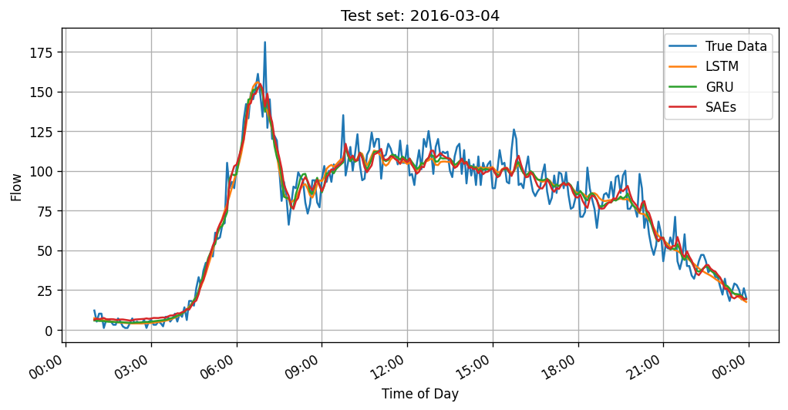
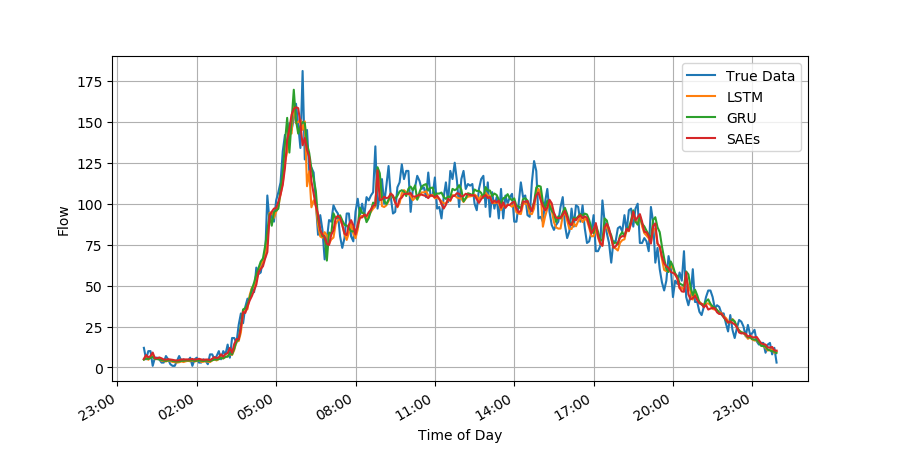

# Traffic Flow Prediction

Short-term traffic flow prediction with deep neural networks. Three models — **LSTM**, **GRU**
and **Stacked Auto-Encoders (SAEs)** — are trained on 5-minute freeway traffic flow data and
compared on their next-step forecasting accuracy.

> **Status: Phase 2 (modernised stack).** This started as a university capstone project.
> The code now runs on Keras 3 / TensorFlow 2. The original Keras 2.1 weights still load and
> reproduce the original numbers, but models retrained with the new code are **not yet as
> accurate** — see [Results](#results-as-reported-by-the-original-project).

## Attribution

The model code is based on an open-source traffic flow prediction project released under the
MIT License (Copyright (c) 2018 Larry — see [LICENSE](LICENSE)). Keep this notice in any
redistribution. Data come from the Caltrans Performance Measurement System (PeMS).

## How it works

1. Load the `Lane 1 Flow (Veh/5 Minutes)` series and scale it to [0, 1] (scaler fit on train only).
2. Build sliding windows: the previous `lag` readings (default 12 = 1 hour) predict the next one.
3. Train an LSTM, GRU or SAEs model (MSE loss, RMSprop, batch 256, 600 epochs).
4. Load trained models, predict on the test set and compare with the ground truth.

## Project structure

```
.
├── src/traffic_flow/
│   ├── data.py         # loading, scaling, windowing
│   ├── models.py       # LSTM, GRU, SAEs definitions (Keras 3)
│   ├── legacy.py       # load original Keras 2.1 .h5 weights into the new models
<<<<<<< HEAD
│   ├── baselines.py    # Persistence, Ridge, gradient boosting
│   ├── experiment.py   # multi-seed runs: python -m traffic_flow.experiment
│   ├── forecast.py     # multi-horizon forecaster (gradient boosting + time features)
│   ├── predict.py      # python -m traffic_flow.predict
│   ├── api.py          # FastAPI app: uvicorn traffic_flow.api:app
=======
>>>>>>> origin/main
│   ├── metrics.py      # MAE, MSE, RMSE, MAPE, R², explained variance
│   ├── train.py        # python -m traffic_flow.train --model lstm|gru|saes|all
│   └── evaluate.py     # python -m traffic_flow.evaluate [--legacy]
├── data/
│   ├── raw/            # train.csv, test.csv  (see data/README.md)
│   └── README.md
├── artifacts/
│   └── legacy/         # original trained weights (.h5) and loss histories
├── docs/images/        # model diagrams and result plot
├── tests/              # data, metrics, models, legacy weights, training smoke tests
├── requirements.txt          # TensorFlow 2 + Keras 3
├── requirements-dev.txt      # + pytest
└── pyproject.toml
```

## Quick start

Requires Python 3.10+.

```bash
make install       # or: pip install -r requirements.txt && pip install -e .

<<<<<<< HEAD
# Train (stops by itself, usually after 60-90 epochs; --original-recipe for the old settings)
python -m traffic_flow.train --model lstm        # or gru, saes, all (about a minute each)
python -m traffic_flow.train --model all --features               # with time-of-day inputs (better)
python -m traffic_flow.train --model all --features --horizon 12 --out-dir artifacts/h60   # 60 minutes ahead
=======
# Train (600 epochs; use --epochs 2 for a quick check)
python -m traffic_flow.train --model lstm        # or gru, saes, all
>>>>>>> origin/main

# Evaluate models trained by `train.py` (default folder: artifacts/)
python -m traffic_flow.evaluate

# Evaluate the Keras 3 models retrained in Phase 2 (kept in artifacts/keras3/)
python -m traffic_flow.evaluate --weights-dir artifacts/keras3

# Evaluate the original Keras 2.1 weights (artifacts/legacy/*.h5)
python -m traffic_flow.evaluate --legacy --legacy-windows
```

Evaluation writes `metrics.csv` and `comparison.png` to `artifacts/eval/` (or `--out-dir`).
The plot shows the first full day of the test set.

<<<<<<< HEAD
### Forecasts, API and dashboard

The forecaster takes the last hour of readings and predicts 5, 15, 30 and 60 minutes ahead.
It uses gradient boosting with time features (the most accurate model on this data) and is
fitted on first use in about a second; TensorFlow is not needed for it.

```bash
make predict        # forecast from the last hour of data/raw/test.csv
python -m traffic_flow.predict --time "2016-03-04 08:00" \
    --readings 98 105 110 121 118 125 130 128 135 131 140 138
make forecaster     # refit and print accuracy per horizon
```

API and dashboard need the extra packages in `requirements-app.txt` (`make install-dev`
installs them):

```bash
make api            # http://127.0.0.1:8000/docs  ->  GET /health, GET /model, POST /predict
make dashboard      # opens the dashboard in your browser
```

```bash
curl -X POST http://127.0.0.1:8000/predict -H "content-type: application/json" \
  -d '{"readings":[98,105,110,121,118,125,130,128,135,131,140,138],"last_timestamp":"2016-03-04T08:00:00"}'
```

The dashboard shows a forecast from any moment of a test day next to what really happened,
the whole day at a chosen horizon, the accuracy table, and an optional comparison with the
saved LSTM / GRU / SAEs models.

Forecaster accuracy on the test set (fitted on all 27 training days):

| Minutes ahead | MAE | RMSE | MAPE | MAE of repeating the last reading |
| --- | :---: | :---: | :---: | :---: |
| 5 | 6.54 | 8.95 | 16.3% | 8.40 |
| 15 | 6.89 | 9.55 | 16.5% | 10.34 |
| 30 | 6.96 | 9.77 | 16.4% | 13.12 |
| 60 | 7.14 | 9.94 | 16.4% | 18.45 |

### Validation and baselines

- `train.py` holds out the **last 5 days of the training file** as a validation set
  (`--val-days`, 0 to disable). The model never trains on those days, and they come after
  all training days, so `val_loss` is now an honest signal.
- `evaluate.py` adds three baselines to every table: **Persistence** (repeat the last
  reading), **Ridge** (linear regression on the 12 lags) and **GradBoost** (gradient boosting
  on the 12 lags). Each trains in under a second.
- `experiment.py` trains each model with several seeds and reports mean ± standard deviation:

```bash
python -m traffic_flow.experiment --seeds 1 2 3     # or: make experiment (about 10 minutes)
```

It is resumable: finished runs are kept in `artifacts/experiment/runs.csv` and skipped.

=======
>>>>>>> origin/main
### Makefile shortcuts

```bash
make install        # dependencies + editable install
make test           # unit and regression tests (~20 s)
make smoke          # whole pipeline on 2 epochs in a temp dir, with output checks (~1 min)
make train MODEL=lstm EPOCHS=600 SEED=42
make evaluate
<<<<<<< HEAD
make experiment SEEDS="1 2 3" EPOCHS=600   # multi-seed comparison with baselines
=======
>>>>>>> origin/main
make reproduce      # check that the original weights still give the README numbers
make help           # list everything
```

CI (`.github/workflows/ci.yml`) runs `make test` and `make smoke` on Python 3.11 and 3.12.

The original Keras 2.1 `.h5` files cannot be loaded with `keras.saving.load_model`.
`traffic_flow.legacy` rebuilds the architecture with the original `hard_sigmoid` gates and
copies the weights across.

## Tests

```bash
pip install -r requirements-dev.txt
pytest
```

`tests/test_legacy_weights.py` checks that the original weights reproduce the MAE and MSE
in the original README. The rest run quickly on tiny synthetic data.

```
```

## Results

<<<<<<< HEAD
All numbers are on the test set (15 days), with windows that never span a gap in the
timestamps. Neural models: mean ± standard deviation over 3 seeds, trained on 22 days with the
last 5 training days held out for validation. Raw files: `docs/results/step2/`.

| Model | Test MAE | Test RMSE | Test MAPE | Epochs run | Training time |
| --- | :---: | :---: | :---: | :---: | :---: |
| LSTM | 7.36 ± 0.02 | 9.96 ± 0.02 | 20.2% ± 0.3 | 74 | 58 s |
| GRU | 7.41 ± 0.08 | 10.04 ± 0.10 | 20.1% ± 0.9 | 68 | 87 s |
| SAEs | 7.57 ± 0.03 | 10.19 ± 0.03 | 21.9% ± 0.3 | 70 | 52 s |
| Persistence (repeat last reading) | 8.40 | 11.38 | 20.3% | – | – |
| Ridge (linear, 12 lags) | 7.59 | 10.33 | 21.5% | – | < 1 s |
| GradBoost (12 lags) | 7.29 | 9.91 | 18.3% | – | < 1 s |

Training time is on one CPU core. This table is without time features; see the next
section for the better results with them.

What this shows:

- LSTM and GRU beat linear regression; SAEs roughly match it. **None beats gradient boosting**,
  which trains in under a second on the same inputs.
- On MAPE the neural models are no better than persistence. MAPE is dominated by the
  low-traffic night hours, where a small absolute error is a large percentage.

### Time features and longer horizons (step 3)

`--features` adds the time of day and day of week of the target time to every model's
inputs. `--horizon N` predicts N steps (N × 5 minutes) ahead. Test MAE, neural models as the
mean over seeds (3 seeds at 5 minutes, 2 at the other horizons; SAEs at 30 minutes is a
single seed). Raw files: `docs/results/step3/`.

| Horizon | LSTM | GRU | SAEs | GradBoost | Ridge | Persistence | Time-of-day average |
| --- | :---: | :---: | :---: | :---: | :---: | :---: | :---: |
| 5 min | 6.96 | 6.88 | 7.07 | **6.65** | 7.50 | 8.40 | 7.92 |
| 15 min | 7.25 | 7.16 | 7.87 | **6.93** | 9.35 | 10.34 | 7.93 |
| 30 min | 7.31 | 7.38 | 7.76 | **7.14** | 11.64 | 13.12 | 7.95 |
| 60 min | 7.54 | 7.55 | 7.98 | **7.29** | 15.08 | 18.44 | 7.99 |

All models in this table except Persistence and the time-of-day average use the time
features. "Time-of-day average" predicts the mean training flow for that time of day and
uses no recent readings at all.

- **Time features help every model.** At 5 minutes: LSTM 7.36 → 6.96, GRU 7.41 → 6.88,
  SAEs 7.57 → 7.07, GradBoost 7.29 → 6.65. LSTM MAPE falls from 20% to 16%.
- **They matter most at long horizons.** Without them the LSTM's 60-minute MAE is 10.38;
  with them 7.54. GradBoost goes from 10.42 to 7.29.
- **Gradient boosting is the best model at every horizon**, by 0.2–0.3 MAE over the best
  neural model, and it trains in under a second.
- **Most of the signal is the daily pattern.** The time-of-day average alone scores about
  7.9 at every horizon. At 60 minutes the best model is only 9% better than it.
- SAEs is the weakest of the three neural models at every horizon.

`artifacts/keras3/` now holds the 5-minute models trained with time features (seed 1).



### More data: PeMS08 (step 4)

PeMS08 is a public benchmark: 170 sensors, 62 days (July–August 2016) of 5-minute data with
weekends. It is not stored in this repository; fetch it with `scripts/download_pems08.sh`
and run `python scripts/step4_experiment.py`. Flow here is the total over all lanes, so MAE
values are on a different scale from the tables above. Last 15 days = test, 5 days before =
validation, N days before that = training. Every model uses the time features. Raw files:
`docs/results/step4/`.

**Does more data help?** Test MAE, 5-minute forecast, one sensor at a time:

| Training days | Sensor 100: LSTM | Sensor 100: GradBoost | Sensor 0: LSTM | Sensor 0: GradBoost |
| --- | :---: | :---: | :---: | :---: |
| 10 | 11.12 | **10.45** | 21.23 | **20.41** |
| 20 | 10.60 | **10.05** | 20.60 | **20.11** |
| 40 | 9.82 ± 0.05 | 9.88 | 19.90 ± 0.01 | **19.55** |

The 40-day LSTM numbers are the mean of 3 seeds; the others are single runs.

- **The gap closes as data grows.** On sensor 100 gradient boosting leads by 0.67 MAE with
  10 days, 0.55 with 20, and the two are level with 40 (the 0.06 difference is about one
  standard deviation of the seeds). On sensor 0 the lead shrinks from 0.82 to 0.35.
- At 60 minutes with 40 days the two are also close: sensor 100, LSTM 10.74 vs GradBoost
  10.71; sensor 0, 23.97 vs 23.62 (single runs).
- So the earlier result (gradient boosting always wins) was partly a small-data result. With
  40 days the LSTM catches up on one sensor; it does not pull ahead on either.
- Sensor 0 has an 8-day stretch (26 July – 2 August) where daily traffic jumps from about
  96k to 122k vehicles and then returns. Treat its numbers with more caution than sensor 100's.

**Does pooling sensors help?** One model trained on 6 sensors together (40 days each),
tested per sensor, 5-minute forecast:

| | Sensor 100 | Sensor 0 |
| --- | :---: | :---: |
| LSTM, own sensor only | 9.82 | 19.90 |
| LSTM, pooled | 10.41 | 20.47 |
| GradBoost, own sensor only | 9.88 | 19.55 |
| GradBoost, pooled | 10.22 | 19.95 |

Pooling made both models worse, and the pooled LSTM took 343 s to train against about 80 s.
The pooled models are not told which sensor a row comes from, so they cannot learn each
sensor's own daily profile. A sensor identifier, or a graph model that uses the road
network, is what the benchmark papers use for this; neither was tried here.

### How the training recipe was chosen

The original recipe (RMSprop, lr 1e-3, fixed 600 epochs) learns slowly. With it, after 100
epochs (3 seeds, `docs/results/step1_100epochs/`): LSTM 8.25 ± 0.20, GRU 8.34 ± 0.28,
SAEs 9.19 ± 0.34 — worse than linear regression.

A screening run on the LSTM (one seed, 60 epochs, `docs/results/step2/screening_lstm_60epochs.csv`):

| Recipe | Test MAE | Time |
| --- | :---: | :---: |
| RMSprop, lr 1e-3 (original) | 8.51 | 46 s |
| Adam, lr 1e-3 | 7.45 | 45 s |
| Adam, lr 3e-3 | 7.32 | 45 s |
| Adam, lr 1e-3, batch 64 | 7.32 | 77 s |
| RMSprop + legacy `hard_sigmoid` gates | 8.52 | 78 s |
| Adam + legacy `hard_sigmoid` gates | 7.45 | 79 s |

- The optimizer is what matters. The legacy gate activation makes no difference to accuracy
  and is about 70% slower.
- Early stopping needs a minimum-improvement threshold (`--min-delta`): validation loss keeps
  falling by tiny amounts, so without it an Adam run used all 600 epochs (455 s) to reach
  MAE 7.30, against 7.34 in 68 s for the same seed with the threshold.

The screening is one seed per recipe, so treat small differences in it as noise.

### Original weights (reference)

The Keras 2.1 weights shipped with the original project, loaded into the Keras 3 code:

| Model | MAE, original windowing | MAE, corrected windowing | MAPE, corrected |
| --- | :---: | :---: | :---: |
| LSTM | 7.22 | 7.28 | 16.4% |
| GRU | 7.20 | 7.26 | 16.6% |
| SAEs | 7.06 | 7.12 | 17.6% |

The "original windowing" column reproduces the original README exactly (`make reproduce`).
These weights are still slightly better than the retrained models, most clearly on MAPE
(16–18% against 20–22%). They were trained on all 27 days rather than 22, and how they were
trained is not known, so the reason for the gap is open.
=======
**Original weights** (`--legacy`, reproduce the original README exactly):

| Model | MAE | MSE | RMSE | MAPE | R² | Explained var. |
| --- | :---: | :---: | :---: | :---: | :---: | :---: |
| LSTM | 7.216 | 98.05 | 9.90 | 16.59% | 0.9396 | 0.9419 |
| GRU  | 7.202 | 99.32 | 9.97 | 16.78% | 0.9389 | 0.9389 |
| SAEs | 7.058 | 92.08 | 9.60 | 17.80% | 0.9433 | 0.9443 |

**Retrained with the Keras 3 code** (`train.py --model all --seed 42`, 600 epochs, `artifacts/keras3/`).
These were trained with the **old** windowing (see below), so they are not yet comparable with the
corrected evaluation:

| Model | MAE | MSE | RMSE | MAPE | R² | Explained var. |
| --- | :---: | :---: | :---: | :---: | :---: | :---: |
| LSTM | 7.688 | 105.62 | 10.28 | 24.43% | 0.9350 | 0.9396 |
| GRU  | 7.776 | 107.98 | 10.39 | 24.89% | 0.9335 | 0.9385 |
| SAEs | 8.065 | 115.56 | 10.75 | 25.13% | 0.9289 | 0.9355 |

The retrained models are about 6–14% worse on MAE than the original weights, and they do
not reproduce the original numbers. Single seed only. The likely cause is that `train.py`
uses the modern `sigmoid` gate for the recurrent layers, not the legacy `hard_sigmoid`
gate the original weights were trained with. This is a hypothesis that has not been tested
yet.

**Corrected windowing** (current default): windows never span a gap in the timestamps. The
original weights give MAE 7.28 / 7.26 / 7.12 (LSTM / GRU / SAEs) with it, compared with 7.22 /
7.20 / 7.06 under the original windowing. Retraining with the corrected windows is the next step.

**Baselines** (same test windows):

| Baseline | MAE | RMSE | MAPE |
| --- | :---: | :---: | :---: |
| Persistence (previous 5-min value) | 8.34 | 11.31 | 20.56% |
| Seasonal naive (same time yesterday) | 10.21 | 14.06 | 24.43% |

The neural models improve MAE over plain persistence by only 3–14%. The retrained models
beat persistence on MAE but not on MAPE. A proper baseline comparison is part of Phase 3.



**Baseline check (computed on `data/raw/test.csv`, same windows as the models):**

| Baseline | MAE | RMSE | MAPE |
| --- | :---: | :---: | :---: |
| Persistence (predict previous 5-min value) | 8.34 | 11.31 | 20.56% |
| Seasonal naive (same time yesterday) | 10.21 | 14.06 | 24.43% |

The neural models improve MAE over plain persistence by only about 14%. A proper baseline
comparison is part of Phase 3.


>>>>>>> origin/main

## Issues found and fixed in the testing pass

- **Windows crossed timestamp gaps.** The train and test files contain whole missing days
  (10 gaps in train, 5 in test). Windows spanning a gap were treated as consecutive readings.
  Fixed; `process_data(..., contiguous=False)` keeps the old behaviour for reproduction.
- **Plot time axis was off by one hour** and had a hard-coded date. It now plots the first full
  day of the test set, selected by timestamp.
- **Missing or wrong paths gave raw Keras/pandas tracebacks.** Now they give a short message
  that says what is missing and how to fix it.
- **TensorFlow C++ logs** flooded the console. Silenced by default (`TF_CPP_MIN_LOG_LEVEL`).
- **Smoke-test fixture** wrote CSVs without timestamps; the tests now use the real file format.
- **Reproducibility** checked: same seed gives identical weights, different seeds do not.

## Known limitations

- Single detector, single lane, univariate input, one-step-ahead only.
<<<<<<< HEAD
- With the default 5 validation days the models train on 22 of the 27 days. `--val-days 0`
  trains on everything but then has no early stopping; set `--epochs` (about 80) yourself.
=======
- Training windows are shuffled before `validation_split`, so the validation loss leaks
  (overlapping windows) and cannot be trusted; no early stopping.
>>>>>>> origin/main
- Missing values are filled with 0. The raw files contain no NaNs, and the few zero readings
  are mostly genuine low-traffic hours, so this has limited effect.
- The "SAEs" layers are trained to predict the target, not to reconstruct the input.
- Small dataset (about 27 training days, 15 test days).

## Roadmap

<<<<<<< HEAD
- [x] Repo cleanup, structure, attribution
- [x] Modern stack (Keras 3 / TensorFlow 2); original weights still load
- [x] Testing pass: gap-aware windows, smoke test, Makefile, CI
- [x] **Step 1 (evaluation)** — chronological validation split, baselines in every table, multi-seed experiment runner
- [x] **Step 2 (training)** — Adam, learning-rate schedule, early stopping; about 8x faster and more accurate than the original recipe
- [x] **Step 3 (features and horizons)** — time-of-day features, 15/30/60-minute forecasts. No neural model beat gradient boosting, so no new architectures were added
- [x] **Step 4 (data)** — PeMS08 benchmark: with 40 days the LSTM draws level with gradient boosting on one sensor; naive pooling of sensors hurts
- [x] **Step 5 (usability)** — `predict` command, HTTP API, dashboard (no config file or Docker image yet)
=======
- [x] **Phase 1** — repo cleanup, structure, attribution, tests for the data pipeline
- [~] **Phase 2** — modern stack (Keras 3 / TF 2) done; retrained models do not yet match the original accuracy (see Results)
- [x] **Testing pass** — end-to-end smoke test, Makefile, CI, bug fixes (see above)
- [ ] **Phase 3** — chronological split, proper validation, baselines, multi-seed evaluation
- [ ] **Phase 4** — time features, multi-step horizons, new models
- [ ] **Phase 5** — CLI/config, API + dashboard, Docker, CI
- [ ] **Phase 6** — documentation and report
>>>>>>> origin/main

## References

```
@article{SAEs,
  title={Traffic Flow Prediction With Big Data: A Deep Learning Approach},
  author={Y Lv, Y Duan, W Kang, Z Li, FY Wang},
  journal={IEEE Transactions on Intelligent Transportation Systems, 2015, 16(2):865-873},
  year={2015}
}

@article{RNN,
  title={Using LSTM and GRU neural network methods for traffic flow prediction},
  author={R Fu, Z Zhang, L Li},
  journal={Chinese Association of Automation, 2017:324-328},
  year={2017}
}
```

## License

MIT — see [LICENSE](LICENSE).
