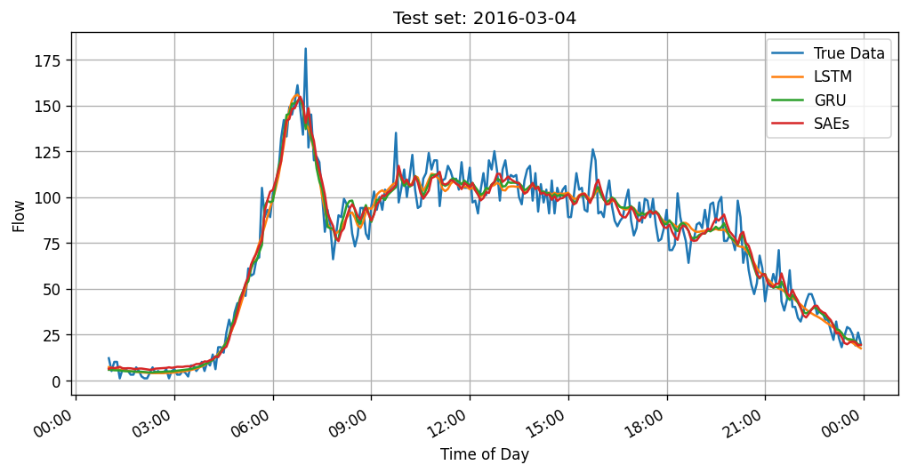

# Traffic Flow Prediction

[](https://github.com/RakibulIslam39/traffic-flow-prediction-Python/actions/workflows/ci.yml)

Short-term traffic flow forecasting: given the last hour of vehicle counts from a road sensor
(one reading every 5 minutes), predict how many vehicles will pass 5, 15, 30 or 60 minutes
from now. The project compares three neural networks (**LSTM**, **GRU** and **Stacked
Auto-Encoders**) against simple baselines, and ships a ready-to-use forecaster with a command
line tool, an HTTP API and a dashboard.

It began as a university capstone project, built on an existing open-source implementation, and
has since been modernised, corrected and extended. The short version of what we found:

- **Time of day matters more than the choice of model.** Adding the time of day and day of
  week as inputs improved every model, most strongly for forecasts an hour ahead, where the
  error dropped by 27 to 30%. At that horizon the best model is only about 9% more accurate
  than simply predicting the average flow for that clock time.
- **On this small dataset (27 days, one sensor) gradient boosting is the most accurate model**
  at every horizon and trains in under a second. The neural networks are 0.2 MAE behind it.
- **More data narrows the gap.** On a larger public benchmark, an LSTM trained on 40 days drew
  level with gradient boosting on one of two sensors, but did not overtake it.
- **The original training recipe was slow, not wrong.** Switching to the Adam optimizer made
  the models clearly more accurate, and early stopping cut training from about 7.5 minutes
  to about 1 minute.

## Contents

1. [Attribution](#attribution)
2. [Quick start](#quick-start)
3. [How it works](#how-it-works)
4. [Forecasts, API and dashboard](#forecasts-api-and-dashboard)
5. [Results](#results)
6. [Reproducing the experiments](#reproducing-the-experiments)
7. [Project structure](#project-structure)
8. [Tests and CI](#tests-and-ci)
9. [Troubleshooting](#troubleshooting)
10. [Towards real-world use](#towards-real-world-use)
11. [Known limitations](#known-limitations)
12. [Issues found and fixed](#issues-found-and-fixed)
13. [Roadmap](#roadmap)
14. [References and license](#references-and-license)

## Attribution

The model code is based on an open-source traffic flow prediction project released under the
MIT License (Copyright (c) 2018 Larry; see [LICENSE](LICENSE)). Keep this notice in any
redistribution. The data come from the Caltrans Performance Measurement System (PeMS).

## Quick start

**Requirements.** Python 3.11 or 3.12 (both are tested in CI; `pyproject.toml` declares 3.10
or newer). TensorFlow publishes no builds for the newest Python releases: on Python 3.15, pip
found no matching TensorFlow, so use 3.12 if your system Python is newer. On an Intel Mac pip
installed TensorFlow 2.16.2, and training and evaluation worked.

```bash
git clone https://github.com/RakibulIslam39/traffic-flow-prediction-Python.git
cd traffic-flow-prediction-Python

python3.12 -m venv .venv
source .venv/bin/activate              # Windows: .venv\Scripts\activate
python -m pip install --upgrade pip
python -m pip install -r requirements-dev.txt
python -m pip install -e . --no-deps
```

`make install-dev` does the same thing where `make` is available. Activate the environment
again (`source .venv/bin/activate`) every time you open a new terminal.

Then check the installation, train the models and look at the output:

```bash
make test                                              # 73 tests, 1 to 4 minutes

python -m traffic_flow.train --model all --features    # about a minute per model
python -m traffic_flow.evaluate                        # table + artifacts/eval/comparison.png
make predict                                           # forecast from the last hour of test data
make dashboard                                         # interactive view in the browser
```

Training stops by itself once the validation loss stops improving, usually after 60 to 90
epochs. `evaluate` prints one table with the three neural models and three baselines, and
writes `metrics.csv` and `comparison.png` (the first full day of the test set) to
`artifacts/eval/`. It reads `artifacts/` by default, so it needs the models from the training
step; the repository also ships ready-made ones:

```bash
python -m traffic_flow.evaluate --weights-dir artifacts/keras3          # 5-minute models with time features
python -m traffic_flow.evaluate --legacy --legacy-windows               # the original project's Keras 2.1 weights
```

`make train` does not pass `--features`; use the command above for the better models.

### Training options

| Option | Default | Meaning |
| --- | --- | --- |
| `--model` | `lstm` | `lstm`, `gru`, `saes` or `all` |
| `--features` | off | add time of day and day of week as inputs (recommended) |
| `--horizon N` | 1 | predict N steps ahead: 1 = 5 min, 3 = 15 min, 6 = 30 min, 12 = 60 min |
| `--epochs` | 600 | maximum; early stopping usually ends training much sooner |
| `--val-days` | 5 | last N training days held out for validation (0 disables validation and early stopping) |
| `--optimizer`, `--lr` | adam, 0.003 | optimizer and initial learning rate; the rate is halved when validation loss stalls (`--no-reduce-lr` turns this off) |
| `--patience`, `--min-delta` | 20, 5e-6 | early stopping patience and smallest improvement that counts |
| `--seed` | 42 | random seed; the same seed reproduces the same weights |
| `--original-recipe` | off | the original project's settings: RMSprop, no early stopping |
| `--out-dir` | `artifacts` | where weights and loss history are saved |

Each trained model is saved next to a small `.json` file recording its horizon and feature
setting, so `evaluate` picks the right inputs automatically. To keep different horizons apart,
give each its own folder, for example
`--features --horizon 12 --out-dir artifacts/h60`.

## How it works

**Data.** `data/raw/` holds one PeMS detector: the flow in lane 1, counted every 5 minutes,
for 27 training days (4 January to 29 February 2016) and 15 test days (March 2016). Only
weekdays are present, with whole days missing in between. See [data/README.md](data/README.md).

**Windows.** Each sample is the previous 12 readings (one hour) plus the target, which lies
`--horizon` steps after the last reading. A window is only built when all its readings are
exactly 5 minutes apart, so no sample straddles a gap in the recording. Flow is scaled to
[0, 1] using the training data only. With `--features`, the sine and cosine of the target's
time of day and day of week are added; that time is known in advance, so it is not a leak.

**Validation.** The last 5 days of the training file are held out and never trained on, and
they come after every training day. The validation loss therefore measures generalisation
to later days, and early stopping and the learning-rate schedule watch it.

**Models.** LSTM and GRU: two stacked recurrent layers of 64 units, dropout 0.2 and a
sigmoid output. SAEs: three hidden layers of 400 units, pre-trained one layer at a time and
then fine-tuned. All use MSE loss and batch size 256.

**Baselines**, shown in every comparison: *Persistence* (repeat the last reading), *Ridge*
(linear regression on the same inputs) and *GradBoost* (gradient boosting on the same
inputs). Each trains in under a second. They exist to keep the neural networks honest.

## Forecasts, API and dashboard

The forecaster (`forecast.py`) uses gradient boosting with time features, the most accurate
model on this data, with one model per horizon. It fits in about a second on first use,
caches itself in `artifacts/forecaster.joblib`, and does not need TensorFlow.

```bash
make predict                  # forecast from the last hour of data/raw/test.csv
python -m traffic_flow.predict --time "2016-03-04 08:00" \
    --readings 98 105 110 121 118 125 130 128 135 131 140 138
make forecaster               # refit and print accuracy per horizon
```

The API and dashboard need the extra packages in `requirements-app.txt`, which
`requirements-dev.txt` already includes:

```bash
make api                      # http://127.0.0.1:8000/docs  (GET /health, GET /model, POST /predict)
make dashboard                # opens the dashboard in your browser
```

```bash
curl -X POST http://127.0.0.1:8000/predict -H "content-type: application/json" \
  -d '{"readings":[98,105,110,121,118,125,130,128,135,131,140,138],"last_timestamp":"2016-03-04T08:00:00"}'
```

Requests with too few readings, negative values or an invalid timestamp are rejected with HTTP
422. The API has no authentication. The environment variables `TRAFFIC_FORECASTER` and
`TRAFFIC_TRAIN_CSV` choose the model file and training data.

The dashboard shows a forecast from any moment of a test day next to what actually happened,
a whole day at a chosen horizon, the accuracy table, and, on request, a comparison with the
saved LSTM, GRU and SAEs models.

Accuracy of the forecaster on the test set, in vehicles per 5 minutes:

| Minutes ahead | MAE | RMSE | MAPE | MAE of repeating the last reading |
| --- | :---: | :---: | :---: | :---: |
| 5 | 6.54 | 8.95 | 16.3% | 8.40 |
| 15 | 6.89 | 9.55 | 16.5% | 10.34 |
| 30 | 6.96 | 9.77 | 16.4% | 13.12 |
| 60 | 7.14 | 9.94 | 16.4% | 18.44 |

The forecaster is fitted on all 27 training days, whereas the comparison tables below hold 5
days out for validation, so its numbers differ slightly from the GradBoost column there.

## Results

All results are on the 15-day test set, in vehicles per 5 minutes, using windows that never
span a gap. MAE is the mean absolute error (lower is better). Neural-network figures are
means over several seeds; raw per-run files are in `docs/results/`.

### Main comparison: time features at every horizon

Neural models are means over 3 seeds at 5 minutes and 2 seeds at the other horizons (SAEs at
30 minutes is a single seed). Ridge and GradBoost use the time features too; Persistence and
the time-of-day average do not. The time-of-day average predicts the mean training flow for
that clock time and ignores recent readings entirely.

| Horizon | LSTM | GRU | SAEs | GradBoost | Ridge | Persistence | Time-of-day average |
| --- | :---: | :---: | :---: | :---: | :---: | :---: | :---: |
| 5 min | 6.96 | 6.88 | 7.07 | **6.65** | 7.50 | 8.40 | 7.92 |
| 15 min | 7.25 | 7.16 | 7.87 | **6.93** | 9.35 | 10.34 | 7.93 |
| 30 min | 7.31 | 7.38 | 7.76 | **7.14** | 11.64 | 13.12 | 7.95 |
| 60 min | 7.54 | 7.55 | 7.98 | **7.29** | 15.08 | 18.44 | 7.99 |



What the table shows:

- **Time features help every model.** At 5 minutes the LSTM improves from 7.36 to 6.96, the
  GRU from 7.41 to 6.88, SAEs from 7.57 to 7.07 and GradBoost from 7.29 to 6.65.
- **They matter most for longer horizons.** Without them an LSTM forecasting an hour ahead has
  an MAE of 10.38; with them 7.54. GradBoost goes from 10.42 to 7.29.
- **Gradient boosting is best at every horizon,** by roughly 0.2 MAE over the best neural
  network (0.17 to 0.25).
- **Most of the signal is the daily rhythm.** The time-of-day average alone scores about 7.9
  at every horizon, and at 60 minutes the best model is only 9% better than it.
- **SAEs is the weakest neural model at every horizon.**
- Percentage error (MAPE) is dominated by the quiet night hours, where a small absolute error
  is a large percentage, so MAE is the more useful figure here.

Results move a little between machines and library versions. A fresh run on a different
machine (Intel Mac, TensorFlow 2.16) gave 5-minute MAEs of 7.01 (LSTM), 6.86 (GRU), 6.97
(SAEs) and 6.64 (GradBoost): the same ranking, within the seed-to-seed spread of about 0.1.

### Without time features

Mean ± standard deviation over 3 seeds, 22 training days, 5-minute forecast, one CPU core.

| Model | Test MAE | Test RMSE | Test MAPE | Epochs run | Training time |
| --- | :---: | :---: | :---: | :---: | :---: |
| LSTM | 7.36 ± 0.02 | 9.96 ± 0.02 | 20.2% ± 0.3 | 74 | 58 s |
| GRU | 7.41 ± 0.08 | 10.04 ± 0.10 | 20.1% ± 0.9 | 68 | 87 s |
| SAEs | 7.57 ± 0.03 | 10.19 ± 0.03 | 21.9% ± 0.3 | 70 | 52 s |
| Persistence | 8.40 | 11.38 | 20.3% | – | – |
| Ridge | 7.59 | 10.33 | 21.5% | – | < 1 s |
| GradBoost | 7.29 | 9.91 | 18.3% | – | < 1 s |

Here LSTM and GRU beat linear regression and SAEs roughly matches it, but none reaches
gradient boosting.

### How the training recipe was chosen

The original recipe (RMSprop with a learning rate of 0.001 and a fixed 600 epochs) learns
slowly: after 100 epochs, over 3 seeds, the LSTM scored 8.25 ± 0.20, the GRU 8.34 ± 0.28 and
SAEs 9.19 ± 0.34, all worse than linear regression. A screening run on the LSTM (one seed,
60 epochs) compared alternatives:

| Recipe | Test MAE | Time |
| --- | :---: | :---: |
| RMSprop, lr 0.001 (original) | 8.51 | 46 s |
| Adam, lr 0.001 | 7.45 | 45 s |
| Adam, lr 0.003 (now the default) | 7.32 | 45 s |
| Adam, lr 0.001, batch size 64 | 7.32 | 77 s |
| RMSprop + legacy `hard_sigmoid` gates | 8.52 | 78 s |
| Adam + legacy `hard_sigmoid` gates | 7.45 | 79 s |

The optimizer is what matters. The legacy gate activation, which we first suspected, makes no
difference to accuracy and slows training by about 70%. Early stopping also needs a minimum
improvement (`--min-delta`): validation loss keeps creeping down by tiny amounts, so without
that threshold an Adam run used all 600 epochs (455 s) for an MAE of 7.30, against 7.34 in
68 s with it. The screening used one seed per recipe, so small differences in it are noise.

### More data: the PeMS08 benchmark

PeMS08 is a public benchmark with 170 sensors and 62 days of 5-minute data, weekends
included. The file has no timestamps; we take it to start on 1 July 2016, which fits its
weekly pattern. It is not stored in this repository: fetch it with `scripts/download_pems08.sh`
and run `python scripts/step4_experiment.py`. Its flow is summed over all lanes, so MAE values
are on a different scale from the tables above. The last 15 days are the test set, the 5 days
before them validation, and the N days before that training; every model uses time features.

Test MAE, 5-minute forecast, one sensor at a time. The 40-day LSTM figures are means over 3
seeds; all other entries are single runs.

| Training days | Sensor 100: LSTM | Sensor 100: GradBoost | Sensor 0: LSTM | Sensor 0: GradBoost |
| --- | :---: | :---: | :---: | :---: |
| 10 | 11.12 | **10.45** | 21.23 | **20.41** |
| 20 | 10.60 | **10.05** | 20.60 | **20.11** |
| 40 | 9.82 ± 0.05 | 9.88 | 19.90 ± 0.01 | **19.55** |

The gap closes as data grows. On sensor 100 gradient boosting leads by 0.67 with 10 days and
0.55 with 20, and the two are level with 40 days (the 0.06 difference is about one standard
deviation across seeds). On sensor 0 the lead shrinks from 0.82 to 0.35. At 60 minutes with
40 days the two are also close: 10.74 against 10.71 on sensor 100 and 23.97 against 23.62 on
sensor 0 (single runs). In short, the earlier "gradient boosting always wins" was partly a
small-data result, but even at 40 days the LSTM does not pull ahead. Sensor 0 has an 8-day
stretch (26 July to 2 August on that calendar) where daily traffic jumps from about 96,000 to 122,000 vehicles
and then returns, so its numbers deserve more caution than sensor 100's.

Training one model on six sensors at once (40 days each) and testing per sensor made both
models worse:

| | Sensor 100 | Sensor 0 |
| --- | :---: | :---: |
| LSTM, own sensor only | 9.82 | 19.90 |
| LSTM, pooled | 10.41 | 20.47 |
| GradBoost, own sensor only | 9.88 | 19.55 |
| GradBoost, pooled | 10.22 | 19.95 |

The pooled LSTM also took 343 s to train, against about 80 s. The pooled models are not told
which sensor a row comes from, so they cannot learn each sensor's own daily profile. A sensor
identifier, or a graph model that uses the road network, would be the natural next attempts;
neither was tried.

### The original project's weights

The Keras 2.1 weights from the original project still load into the current code:

| Model | MAE, original windowing | MAE, gap-aware windowing | MAPE, gap-aware |
| --- | :---: | :---: | :---: |
| LSTM | 7.22 | 7.28 | 16.4% |
| GRU | 7.20 | 7.26 | 16.6% |
| SAEs | 7.06 | 7.12 | 17.6% |

The first column reproduces the original project's published numbers exactly
(`make reproduce`). These weights are still slightly better than our retrained models without
time features, most clearly on MAPE (16 to 18% against 20 to 22%). They were trained on all 27
days rather than 22, and how they were trained is not documented, so the reason for the gap is
unknown.

## Reproducing the experiments

```bash
make experiment SEEDS="1 2 3"        # 3 seeds, no time features, with baselines (~10 min)
python -m traffic_flow.experiment --seeds 1 2 --features --horizon 12 --tag h60   # any train.py option works
scripts/download_pems08.sh && python scripts/step4_experiment.py     # PeMS08 (~15 min)
make reproduce                       # original weights must still give the original numbers
```

`experiment` is resumable: finished runs are kept in `artifacts/experiment/runs.csv` and
skipped when you start it again. Runs with different `--tag` values are kept apart.

## Project structure

```
.
├── src/traffic_flow/
│   ├── data.py          # loading, scaling, gap-aware windows, validation split, time features
│   ├── models.py        # LSTM, GRU, SAEs (Keras 3)
│   ├── train.py         # python -m traffic_flow.train
│   ├── evaluate.py      # python -m traffic_flow.evaluate
│   ├── experiment.py    # multi-seed runs with baselines
│   ├── baselines.py     # Persistence, Ridge, gradient boosting
│   ├── metrics.py       # MAE, MSE, RMSE, MAPE, R², explained variance
│   ├── forecast.py      # multi-horizon forecaster (gradient boosting + time features)
│   ├── predict.py       # python -m traffic_flow.predict
│   ├── api.py           # FastAPI app: uvicorn traffic_flow.api:app
│   └── legacy.py        # loads the original Keras 2.1 .h5 weights into the new models
├── dashboard/app.py     # Streamlit dashboard
├── scripts/             # smoke_test.sh, download_pems08.sh, step4_experiment.py
├── tests/               # 73 tests
├── data/raw/            # train.csv, test.csv  (see data/README.md)
├── artifacts/
│   ├── keras3/          # 5-minute models with time features, seed 1
│   └── legacy/          # the original project's weights and loss histories
├── docs/
│   ├── images/          # comparison plot and model diagrams
│   └── results/         # raw result files behind every table above
├── .github/workflows/ci.yml
├── Makefile             # `make help` lists every command
├── requirements.txt     # TensorFlow 2 + Keras 3 + scientific stack
├── requirements-app.txt # + FastAPI, uvicorn, Streamlit
├── requirements-dev.txt # + pytest and the app packages
└── pyproject.toml
```

## Tests and CI

```bash
make test        # 73 tests, 1 to 4 minutes depending on the machine
make smoke       # the whole pipeline on tiny settings in a temporary folder, with output checks
make reproduce   # the original weights still reproduce the original numbers
```

The tests cover the data pipeline (gap-aware windows, chronological validation, time
features), metrics, model construction, training with early stopping, the baselines, the
forecaster, the command line, the API and the dashboard. One regression test checks that the
original Keras 2.1 weights still give the original project's metrics.

GitHub Actions (`.github/workflows/ci.yml`) runs `pytest` and `scripts/smoke_test.sh` on
Python 3.11 and 3.12 for every push and pull request; a run takes about three minutes.

## Troubleshooting

| Symptom | Cause and fix |
| --- | --- |
| `command not found: python` | The virtual environment is not active: `source .venv/bin/activate`. |
| `No module named 'traffic_flow'` | Run `python -m pip install -e . --no-deps` inside the active environment. |
| pip finds no matching TensorFlow | Your Python is too new. Create the environment with Python 3.11 or 3.12. |
| `make: *** missing separator`, or pip rejects `<<<<<<< HEAD` | A merge left conflict markers in the files. Find them with `grep -rn '<<<<<<<' --exclude-dir=.venv --exclude-dir=.git .` and resolve them. |
| `evaluate` reports that no models were found | Train first (`python -m traffic_flow.train --model all --features`) or point it at the shipped models with `--weights-dir artifacts/keras3`. |
| Terminal shows `Expected ASGI message 'http.response.start'` while the dashboard runs | The traceback is entirely inside Streamlit's web server, not this project. It appeared on macOS with Streamlit 1.67; we could not reproduce it elsewhere or identify the cause. Try a hard refresh (`Cmd+Shift+R`) or another browser; `evaluate` and `predict` give the same information without the dashboard. |

## Towards real-world use

The repository is a working prototype, not a deployed system. The forecaster and API are the
part that could be used in practice, roughly as follows:

1. A roadside sensor or camera counts vehicles every 5 minutes and sends the counts on.
2. The forecast service keeps the latest 12 readings per sensor and calls `POST /predict`.
3. The predictions feed a dashboard, a mobile app or a signal-control system.

That would enable, for example: lengthening green phases before a rush builds, warning
travellers about congestion half an hour ahead so they can change route or departure time,
flagging incidents when actual flow departs sharply from the forecast, and planning roadworks
or bus schedules around predicted demand.

Before that is realistic, several things are missing:

- **Local data.** The models were trained on one California sensor. A different road needs
  its own history and retraining; the code supports this, but collecting the data is the task.
- **Wider coverage.** The training data contain no weekends, holidays, weather or special
  events, so behaviour in those situations is untested.
- **A live data connection** with handling for sensors that go offline, plus regular
  retraining and monitoring, since traffic patterns drift.
- **Production hardening:** authentication, rate limiting and a container image. The API has
  none of these.

## Known limitations

- One detector and one lane in the main dataset; two sensors tested on PeMS08.
- About 27 training days, weekdays only; 22 of them are used for training when the default 5
  validation days are held out (`--val-days 0` trains on all, without early stopping, so set
  `--epochs` to about 80).
- The API and dashboard serve gradient boosting. The neural models are compared in
  `evaluate` and the dashboard but are not served.
- Missing values are filled with 0. The raw files contain no missing values and the few zero
  readings are mostly genuine quiet hours, so the effect is small.
- The "SAEs" layers are trained to predict the target rather than to reconstruct the input,
  which is not a true auto-encoder; it is the weakest model here.
- Pooling sensors was only tried naively (no sensor identifier, no network structure).

## Issues found and fixed

| Problem | Fix |
| --- | --- |
| Original code needed Python 3.6 / Keras 2.1; the old `.h5` files could not be loaded | Ported to Keras 3; `legacy.py` rebuilds the old architecture and copies the weights; the original numbers reproduce exactly |
| Windows spanned whole missing days (10 gaps in train, 5 in test) and treated them as consecutive | Windows are only built from readings exactly 5 minutes apart |
| Validation windows were shuffled in with training windows, so `val_loss` leaked | The last 5 training days are held out as a chronological validation set |
| Retrained models were worse than the original weights | Traced to the optimizer: Adam instead of RMSprop closed most of the gap; the suspected gate activation had no effect |
| Early stopping never fired and every run used 600 epochs | Added a minimum-improvement threshold (`--min-delta`) |
| Evaluation plot was off by an hour and used a hard-coded date | The plot is built from timestamps and shows the first full test day |
| Missing files gave raw Keras or pandas tracebacks; TensorFlow logs flooded the console | Clear error messages; logging silenced by default |
| No comparison against simple baselines | Persistence, Ridge and gradient boosting appear in every table |

Same seed gives identical weights; different seeds do not.

## Roadmap

Done: repository cleanup, Keras 3 port, gap-aware windows and honest validation, baselines and
multi-seed experiments, faster training, time features and longer horizons, the PeMS08
experiments, and the forecaster with its command line, API and dashboard.

Open ideas, roughly in order of value:

- A sensor identifier or graph model for training on many sensors at once.
- More months of data, including weekends and holidays.
- Understanding why the original weights are slightly better on percentage error.
- A configuration file and a Docker image.
- Serving a neural model alongside the gradient-boosting forecaster.
- CI hardening: require passing checks before merging to `main`, avoid duplicate runs on pull
  requests, and add a lint step.

## References and license

```
@article{SAEs,
  title={Traffic Flow Prediction With Big Data: A Deep Learning Approach},
  author={Y Lv, Y Duan, W Kang, Z Li, FY Wang},
  journal={IEEE Transactions on Intelligent Transportation Systems, 2015, 16(2):865-873},
  year={2015}
}

@article{RNN,
  title={Using LSTM and GRU neural network methods for traffic flow prediction},
  author={R Fu, Z Zhang, L Li},
  journal={Chinese Association of Automation, 2017:324-328},
  year={2017}
}
```

MIT. See [LICENSE](LICENSE).
